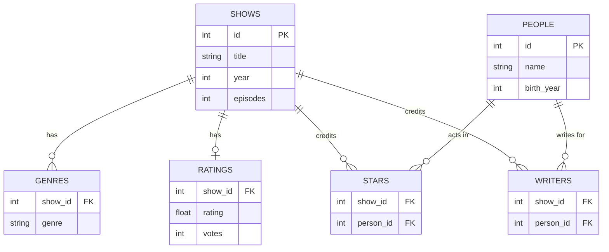

# TV Show Catalog Design Practice

A design for the two pages shown in class: a show's page (title, year, episode
count, genres, rating, stars and writers) and a person's page (the shows they
are in).

## Assumptions

- A show is keyed by a surrogate `id`, not by title, because titles repeat
  (eight shows are called *The Office*).
- `genres` is its own table because a show can have more than one genre.
- `ratings` is zero-or-one per show, because the slides said some shows have
  no rating yet.
- `stars` and `writers` are separate intersection tables rather than one
  table with a role column, so one person can both act and write without the
  two roles mixing in a single row.
- `people` holds everyone, actors and writers alike, because the same person
  can appear in both tables (an actor can write, and a writer can act).
- Neither `stars` nor `writers` declares its own primary key here, matching
  what the real database does: nothing stops the same show/person pair from
  appearing twice.
