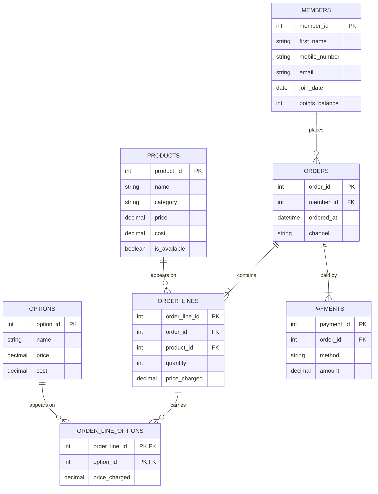

# Babson Bean Café — Database Project

## 1. The Scenario

Scenario C: Babson Bean Café. Babson Bean is a café on campus. Its till records sales and its loyalty program lives on punch cards, and neither can answer a question. The café wants to know what sells, which add-ons earn their keep, and who its regular customers are.

## 2. The ERD

## 3. What One Row Means

- One row of `members` is one loyalty member of the café.
- One row of `products` is one item on the menu.
- One row of `options` is one add-on a drink can carry.
- One row of `orders` is one purchase made at the counter or through the app.
- One row of `order_lines` is one product on one order, with the quantity bought and the price charged that day.
- One row of `order_line_options` is one option added to one order line, with the price charged that day.
- One row of `payments` is one payment made toward one order.

## 4. Design Choices

**The key I chose.** The café already identifies a member by their mobile number, but I gave `members` a surrogate `member_id` instead. The scenario says a member can change their mobile number, and if the mobile number were the primary key, every order tied to that member would either break its foreign key or get silently linked to a "new" member once the number changed. A `member_id` that never changes keeps a member's order history intact no matter how many times their mobile number changes.

**Which relationships are optional.** `orders.member_id` is optional, because the scenario says customers who are not members buy too, and their orders name no customer. `members.email` is also optional, since the scenario lists email as "(optional)" for a loyalty member.

**The rule my tables cannot hold.** An order's payments have to add up to its total — its lines and their options together. A `CHECK` constraint can only look at one row at a time, but this rule compares a sum across three tables (`payments`, `order_lines`, `order_line_options`), so no constraint can enforce it. Instead, `build.py`'s data intentionally breaks this rule in exactly two orders, and Part B's business question checks it with a query that compares each order's payment total against its lines-and-options total.

**One thing I changed from what was proposed.** I kept `order_lines` and `payments` on their own surrogate keys instead of compound keys, even though `order_line_options` uses a compound key. A cart can reasonably hold the same product on two separate lines, and an order can have two payments of the same method, so a compound key on those two tables could wrongly refuse a valid row. The compound key only makes sense on `order_line_options`, where the rule itself says an option can appear at most once per line.

